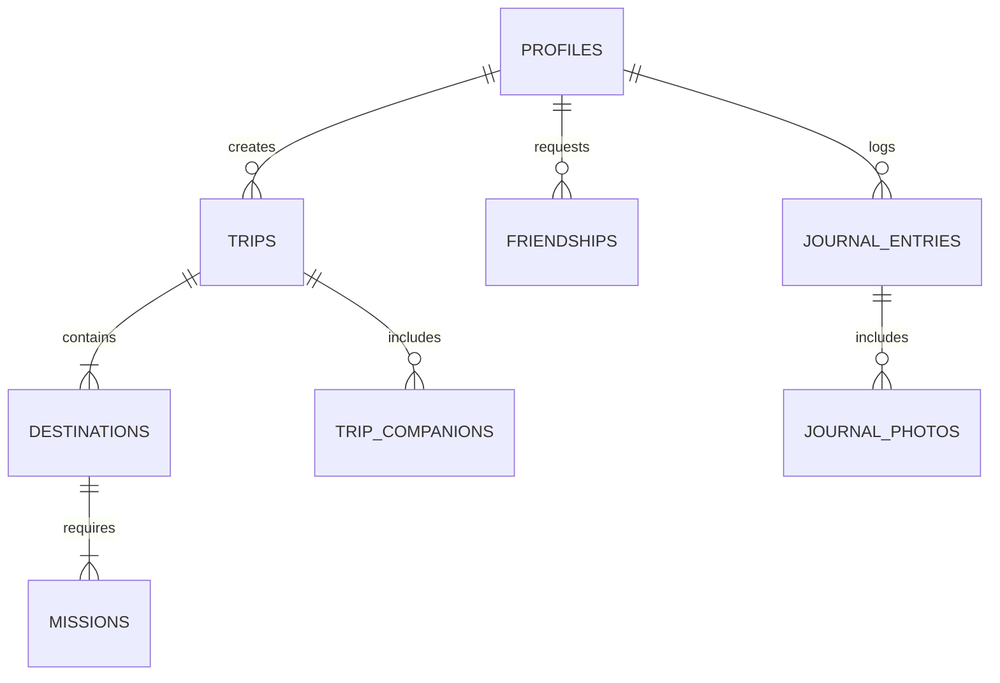

# 🌄 Wanderly

<div align="center">


### *Turn Every Expedition Into a Mystery Quest*

[](https://nextjs.org/)
[](https://www.typescriptlang.org/)
[](https://aistudio.google.com/)
[](https://supabase.com/)
[](https://vercel.com/)
[](LICENSE)

[**Explore Demo**](https://wanderly.app) • [**Deployment Guide**](DEPLOYMENT_GUIDE.md) • [**Database Schema**](supabase/schema.sql) • [**GitHub Repo**](https://github.com/mrkdev766/HACK)

---

</div>

## 📖 Overview

**Wanderly** is a state-of-the-art, AI-powered real-world travel adventure web application that turns urban and wilderness exploration into progressive **mystery quests**. 

Enter your starting location, budget, duration, preferred transit mode (**Walking**, **Public Transit**, or **Personal Vehicle**), and travel vibe. Google Gemini AI constructs a multi-stop real-world quest where future destinations remain mystery surprise nodes until current missions are completed, documented, and verified!

---

## 🔌 APIs & External Services Integration

Wanderly leverages a multi-tiered ecosystem of open-data APIs, geospatial engines, and LLMs to research regional corridors, synthesize accurate budget models, and present interactive maps:

| API / Data Source | Purpose & Endpoint | Key Usage in Wanderly |
| :--- | :--- | :--- |
| **Google Gemini AI API** | `models/gemini-2.5-flash:generateContent` | Dynamic mystery itinerary generation, gamified checkpoint missions, and mode-tailored transit prompt engineering. |
| **OpenStreetMap Nominatim API** | `nominatim.openstreetmap.org/search` & `/reverse` | Zero-cost geocoding, reverse geocoding, coordinate resolution, and regional bounding box detection without API keys. |
| **Wikipedia / Wikivoyage REST API** | `en.wikipedia.org/api/rest_v1/page/summary` | Real-time regional travel excerpts, cultural lore, and heritage context used to ground LLM prompts with authentic facts. |
| **Google Maps & OSM Tile Services** | `mt1.google.com/vt/lyrs=...` & `tile.openstreetmap.org` | High-contrast interactive map canvas rendering (Terrain, Roads, Satellite) via Leaflet map engine. |
| **DiceBear Avatars API** | `api.dicebear.com/7.x/bottts/svg` | Dynamic SVG explorer avatar generation for community profiles and guest travelers. |
| **Unsplash Image Curator** | `images.unsplash.com` | High-resolution location photography curated for destination cards and mystery waypoints. |

---

## 🔄 Self-Improving Itinerary Engine & Community Feedback Loop

While AI models excel at creative route generation, LLM assumptions about local bus fares, roadside eateries, or exact ticket prices can occasionally be inaccurate. **Wanderly solves this via a hybrid AI + Community Correction loop:**

```
┌──────────────────────────┐
│  1. AI Agent Synthesis   │  (Generates initial mystery route & estimated budget)
└────────────┬─────────────┘
             │
             ▼
┌──────────────────────────┐
│  2. Field Exploration    │  (Traveler completes missions & logs real-world spend)
└────────────┬─────────────┘
             │
             ▼
┌──────────────────────────┐
│ 3. Traveler Correction   │  (Traveler updates actual spend, bus/metro tips & shop notes)
└────────────┬─────────────┘
             │
             ▼
┌──────────────────────────┐
│ 4. Public Quest Publish  │  (Corrected quest is published to Community Discovery Feed)
└────────────┬─────────────┘
             │
             ▼
┌──────────────────────────┐
│ 5. Cumulative Improvement│  (Future travelers clone battle-tested, crowd-verified routes!)
└──────────────────────────┘
```

### How Community Contributions Improve Mystery Quests Over Time:
1. **Initial AI Blueprint**: Google Gemini constructs the initial route with estimated costs (e.g. ₹2,500 budget allocation).
2. **Real Field Data Capture**: When a traveler visits a waypoint, they record **actual expenditure**, specify **exact transport choices** (e.g., *Take SWTD Ferry #4 for ₹18 instead of private boat*), and append local shop tips.
3. **Publishing & Community Discovery**: The traveler publishes their corrected itinerary with custom title tags and vibe badges.
4. **Crowdsourced Evolution**: As other community members clone and experience the published quest, Wanderly's regional knowledge base is continuously enriched with verified, crowd-tested mystery routes!

---

## 🔬 Technical Architecture & Deep-Dive (Question Raising Parts)

### 1. Server-Authoritative Mystery Lock & Redaction
* **Question**: *How does Wanderly prevent tech-savvy users from inspecting network payloads in DevTools to reveal locked mystery destinations ahead of time?*
* **Solution**: locked destination names, coordinates, images, and mission details are redacted on the server side (`TripService.redactDestination`). The client API payload only receives placeholder metadata for locked nodes. Unlocking occurs strictly on the server upon valid mission completion.

### 2. Atomic Mission Completion & Double-Claim Prevention
* **Question**: *How are points, coin rewards, and destination state transitions kept cheat-proof against race conditions?*
* **Solution**: Mission completions execute within a single PostgreSQL stored procedure (`public.complete_destination_mission`). This database transaction atomically:
  - Verifies trip ownership and current unlock state.
  - Inserts a record into `mission_completions` (enforced by a `UNIQUE(user_id, mission_id)` constraint to prevent double-claiming).
  - Updates the completed destination status to `completed`.
  - Unlocks the next sequential destination (`sequence_number + 1`) to `unlocked`.
  - Records journal notes and photos inside the same transaction boundary.

### 3. Mode-Tailored Transit Strategy Engine
* **Question**: *How does the planner adapt when switching between Walking, Public Transit, and Personal Driving?*
* **Solution**: The `TripPlannerService` adjusts geospatial spacing, travel time calculations, and LLM prompt rules based on the selected mode:
  - **Walking Mode**: Restricts waypoint spacing to dense **1–4 km** radii, prioritizes pedestrian paths, and calculates foot travel minutes.
  - **Public Transit Mode**: Incorporates specific bus line numbers, metro colors, water ferry routes, and share-auto fare models.
  - **Personal Vehicle Mode**: Spans scenic highway corridors (**10–40 km**), calculates fuel/toll allocations, and highlights roadside parking viewpoints.

---

## ✨ Core Features & Highlights

```
┌───────────┐     ┌──────────────┐     ┌────────────────┐     ┌─────────────────┐     ┌──────────────┐
│  PLAN AI  │ ──> │ MYSTERY LOCK │ ──> │ ITEMIZED SPEND │ ──> │ CORRECT & SHARE │ ──> │ CO-TRAVEL    │
└───────────┘     └──────────────┘     └────────────────┘     └─────────────────┘     └──────────────┘
```

### 🗺️ 1. AI-Powered Mystery Itinerary Generator
- **Progressive Mystery Unlocking**: Only your first waypoint is revealed at start; subsequent stops remain locked mystery surprises until you satisfy mission requirements.
- **Geospatial Grounding**: Autonomous integration with OpenStreetMap (Nominatim), Wikipedia travel intelligence, and regional travel corridors.

### 🚌 2. Specialized Transit-Mode Intelligence
- **🚶 Walking Mode**: Spacing restricted to dense 1–4 km radii, pedestrian pathways, walking minutes breakdown, and pedestrian hidden gems/tea shops.
- **🚍 Public Transit Mode**: Connects stops via real metro lines, state bus route numbers, water ferries, and share autos with station-to-station ticket prices in INR.
- **🚗 Personal Vehicle Mode**: Focuses on scenic driving corridors, fuel/toll budget allocations, parking availability tips, and roadside viewpoints.

### 💰 3. Itemized Budget & Eatery/Shop Breakdowns
- **Granular Cost Allocations**: Detailed price tags for transit fares (Bus/Metro/Auto/Taxi), local dining/chai spots, market shopping, and entry tickets.
- **Estimated vs. Actual Spend**: Live tracking of planned budget vs. real field expenditure with variance logging.

### ✍️ 4. AI Agent + Traveler Community Corrections
- **User-Driven Accuracy**: AI itineraries can sometimes miss exact local details. Travelers can update actual expenses, custom notes, and preferred transport options.
- **Public Quest Publishing**: Publish your corrected, battle-tested itineraries to the public discovery feed for other travelers to clone and experience.

### 🌐 5. Social Explorer Network & Live Co-Travel
- **Traveler Profile Search**: Search community profiles, view badges, earned coins, and completed quest histories.
- **Friend Requests**: Send, receive, and manage friend requests.
- **Live Co-Travel Quests**: Join active ongoing quests created by friends or community leaders in real time.

---

## 🛠️ Technology Stack

| Layer | Technology | Description |
| :--- | :--- | :--- |
| **Frontend Framework** | [Next.js 15](https://nextjs.org/) (App Router, React 19) | High-performance React framework with server actions |
| **Language** | [TypeScript](https://www.typescriptlang.org/) (Strict Mode) | Full type safety across components and API routes |
| **Styling & Fonts** | CSS Variables + Google Fonts | Plus Jakarta Sans, Playfair Display, Outfit fonts |
| **AI Engine** | [Google Gemini AI](https://aistudio.google.com/) | Live structured JSON itinerary synthesis & travel research |
| **Database & Auth** | [Supabase](https://supabase.com/) (PostgreSQL + RLS) | Production database with Row Level Security & RPC functions |
| **Storage** | Supabase Storage (`journal-photos`) | Media storage with fallback local storage engine |
| **Validation** | [Zod](https://zod.dev/) | Strict runtime schema validation for inputs and AI outputs |
| **Build & Deploy** | [Vercel](https://vercel.com/) | Edge network deployment with automatic CI/CD |

---

## 🗄️ Database Architecture

Travelholic relies on a production PostgreSQL database schema defined in [`supabase/schema.sql`](supabase/schema.sql):



---

## 🚀 Quick Start Guide

### Prerequisites
- **Node.js** 18+ (tested on Node 24)
- **npm** or **pnpm**

### 1. Clone & Install Dependencies
```bash
git clone https://github.com/mrkdev766/HACK.git
cd HACK
npm install
```

### 2. Configure Environment Variables (Optional for Local Demo Mode)
Copy `.env.example` to `.env.local`:
```bash
cp .env.example .env.local
```

Add your Google Gemini API Key or Supabase credentials:
```env
GEMINI_API_KEY=your_gemini_api_key_here
NEXT_PUBLIC_SUPABASE_URL=https://your-project.supabase.co
NEXT_PUBLIC_SUPABASE_ANON_KEY=your_supabase_anon_key
SUPABASE_SERVICE_ROLE_KEY=your_supabase_service_role_key
```

### 3. Run Development Server
```bash
cmd /c npm run dev
```
Open **[http://localhost:3000](http://localhost:3000)** in your browser!

---

## 🌐 Production Deployment

For complete, step-by-step instructions on deploying Wanderly to **Vercel** and configuring **Supabase PostgreSQL**, read the **[Deployment Guide](DEPLOYMENT_GUIDE.md)**.

---

## 📄 License

This project is open source and available under the [MIT License](LICENSE).

---

<div align="center">

Made with ❤️ by Wanderly Team • *"Small steps. Big stories."*

</div>
