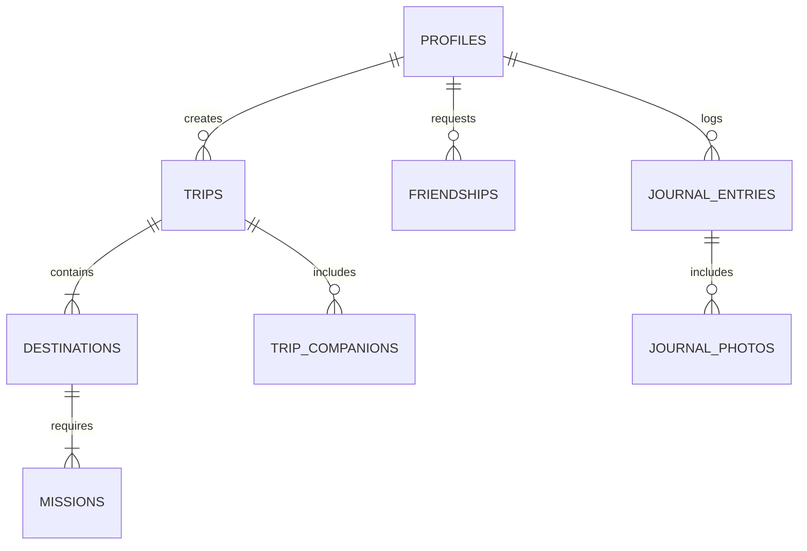

# 🌄 Wanderly

<div align="center">


### *Turn Every Expedition Into a Mystery Quest*

[](https://nextjs.org/)
[](https://www.typescriptlang.org/)
[](https://aistudio.google.com/)
[](https://supabase.com/)
[](https://vercel.com/)
[](LICENSE)

[**Explore Demo**](https://wanderly.app) • [**Deployment Guide**](DEPLOYMENT_GUIDE.md) • [**Database Schema**](supabase/schema.sql) • [**GitHub Repo**](https://github.com/mrkdev766/HACK)

---

</div>

## 📖 Overview

**Wanderly** is a state-of-the-art, AI-powered real-world travel adventure web application that revolutionizes urban and wilderness exploration. Instead of static travel guides, Wanderly turns trips into progressive **mystery quests**. 

Enter your starting location, budget, duration, preferred transit mode (**Walking**, **Public Transit**, or **Personal Vehicle**), and travel vibe. Google Gemini AI constructs a multi-stop real-world quest where future destinations remain mystery surprise nodes until current missions are completed, documented, and verified!

---

## ✨ Core Features & Highlights

```
┌───────────┐     ┌──────────────┐     ┌────────────────┐     ┌─────────────────┐     ┌──────────────┐
│  PLAN AI  │ ──> │ MYSTERY LOCK │ ──> │ ITEMIZED SPEND │ ──> │ CORRECT & SHARE │ ──> │ CO-TRAVEL    │
└───────────┘     └──────────────┘     └────────────────┘     └─────────────────┘     └──────────────┘
```

### 🗺️ 1. AI-Powered Mystery Itinerary Generator
- **Progressive Mystery Unlocking**: Only your first waypoint is revealed at start; subsequent stops remain locked mystery surprises until you satisfy mission requirements.
- **Geospatial Grounding**: Autonomous integration with OpenStreetMap (Nominatim), Wikipedia travel intelligence, and regional travel corridors.

### 🚌 2. Specialized Transit-Mode Intelligence
- **🚶 Walking Mode**: Spacing restricted to dense 1–4 km radii, pedestrian pathways, walking minutes breakdown, and pedestrian hidden gems/tea shops.
- **🚍 Public Transit Mode**: Connects stops via real metro lines, state bus route numbers, water ferries, and share autos with station-to-station ticket prices in INR.
- **🚗 Personal Vehicle Mode**: Focuses on scenic driving corridors, fuel/toll budget allocations, parking availability tips, and roadside viewpoints.

### 💰 3. Itemized Budget & Eatery/Shop Breakdowns
- **Granular Cost Allocations**: Detailed price tags for transit fares (Bus/Metro/Auto/Taxi), local dining/chai spots, market shopping, and entry tickets.
- **Estimated vs. Actual Spend**: Live tracking of planned budget vs. real field expenditure with variance logging.

### ✍️ 4. AI Agent + Traveler Community Corrections
- **User-Driven Accuracy**: AI itineraries can sometimes miss exact local details. Travelers can update actual expenses, custom notes, and preferred transport options.
- **Public Quest Publishing**: Publish your corrected, battle-tested itineraries to the public discovery feed for other travelers to clone and experience.

### 🌐 5. Social Explorer Network & Live Co-Travel
- **Traveler Profile Search**: Search community profiles, view badges, earned coins, and completed quest histories.
- **Friend Requests**: Send, receive, and manage friend requests.
- **Live Co-Travel Quests**: Join active ongoing quests created by friends or community leaders in real time.

### 🏆 6. Gamification & Memories Journal
- **Field Missions**: Photo uploads, note prompts, and explore challenges for every stop.
- **Rewards System**: Earn Gold Coins, Silver Badges, XP points, and level up your wanderer profile.
- **Interactive Lightbox Journal**: Timeline photo gallery, journal entries, and shareable expedition summary cards.

---

## 🛠️ Technology Stack

| Layer | Technology | Description |
| :--- | :--- | :--- |
| **Frontend Framework** | [Next.js 15](https://nextjs.org/) (App Router, React 19) | High-performance React framework with server actions |
| **Language** | [TypeScript](https://www.typescriptlang.org/) (Strict Mode) | Full type safety across components and API routes |
| **Styling & Fonts** | CSS Variables + Google Fonts | Plus Jakarta Sans, Playfair Display, Outfit fonts |
| **AI Engine** | [Google Gemini AI](https://aistudio.google.com/) | Live structured JSON itinerary synthesis & travel research |
| **Database & Auth** | [Supabase](https://supabase.com/) (PostgreSQL + RLS) | Production database with Row Level Security & RPC functions |
| **Storage** | Supabase Storage (`journal-photos`) | Media storage with fallback local storage engine |
| **Validation** | [Zod](https://zod.dev/) | Strict runtime schema validation for inputs and AI outputs |
| **Build & Deploy** | [Vercel](https://vercel.com/) | Edge network deployment with automatic CI/CD |

---

## 🗄️ Database Architecture

Travelholic relies on a production PostgreSQL database schema defined in [`supabase/schema.sql`](supabase/schema.sql):



### Main Database Tables:
- `profiles`: User details, avatars, bio, badges, coins, and achievement stats.
- `trips`: Private and public itineraries with budget, travel style, vibe, transport mode, and clone counts.
- `destinations`: Sequential stops with mystery unlock status (`locked`, `unlocked`, `completed`), actual spend, and custom notes.
- `missions`: Checkpoint objectives, photo counts, instruction prompts, and point rewards.
- `journal_entries`: Personal field logs, actual spend records, and timestamped memories.
- `friendships`: Social connection states (`pending`, `accepted`, `rejected`).
- `trip_companions`: Co-travelers joining live ongoing quests.

---

## 🚀 Quick Start Guide

### Prerequisites
- **Node.js** 18+ (tested on Node 24)
- **npm** or **pnpm**

### 1. Clone & Install Dependencies
```bash
git clone https://github.com/mrkdev766/HACK.git
cd HACK
npm install
```

### 2. Configure Environment Variables (Optional for Local Demo Mode)
Copy `.env.example` to `.env.local`:
```bash
cp .env.example .env.local
```

Add your Google Gemini API Key or Supabase credentials:
```env
GEMINI_API_KEY=your_gemini_api_key_here
NEXT_PUBLIC_SUPABASE_URL=https://your-project.supabase.co
NEXT_PUBLIC_SUPABASE_ANON_KEY=your_supabase_anon_key
SUPABASE_SERVICE_ROLE_KEY=your_supabase_service_role_key
```
*(Note: Travelholic features a built-in demo storage engine that works instantly out-of-the-box even without API keys!)*

### 3. Run Development Server
```bash
cmd /c npm run dev
```
Open **[http://localhost:3000](http://localhost:3000)** in your browser!

---

## 🌐 Production Deployment

For complete, step-by-step instructions on deploying Travelholic to **Vercel** and configuring **Supabase PostgreSQL**, read the **[Deployment Guide](DEPLOYMENT_GUIDE.md)**.

### Summary Deployment Steps:
1. Run [`supabase/schema.sql`](supabase/schema.sql) in your Supabase SQL Editor.
2. Create a public storage bucket named `journal-photos`.
3. Connect your GitHub repository (`mrkdev766/HACK`) to Vercel.
4. Set environment variables in Vercel settings and deploy!

---

## 📄 License

This project is open source and available under the [MIT License](LICENSE).

---

<div align="center">

Made with ❤️ by Travelholic Team • *"Small steps. Big stories."*

</div>
